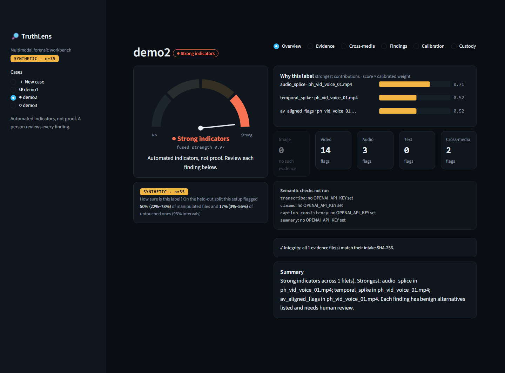
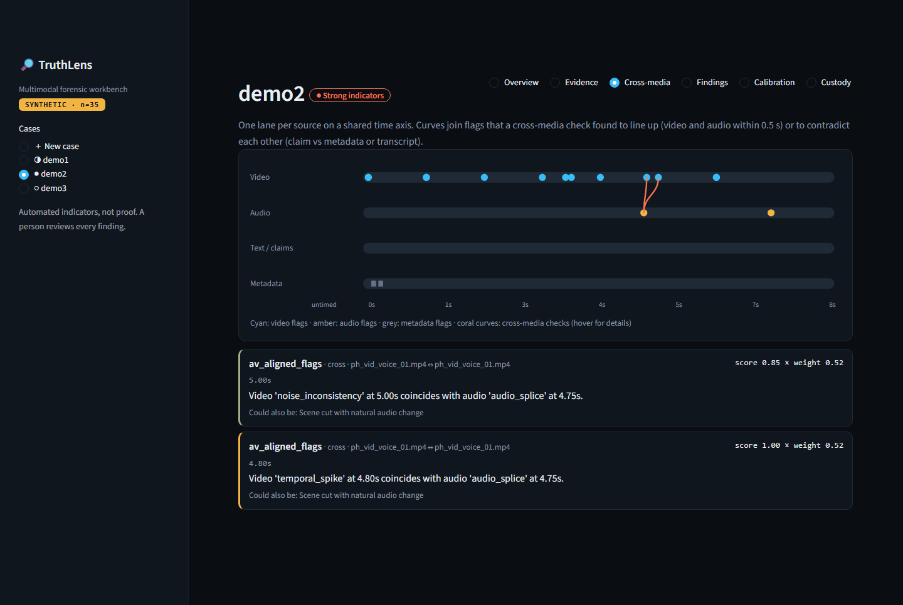
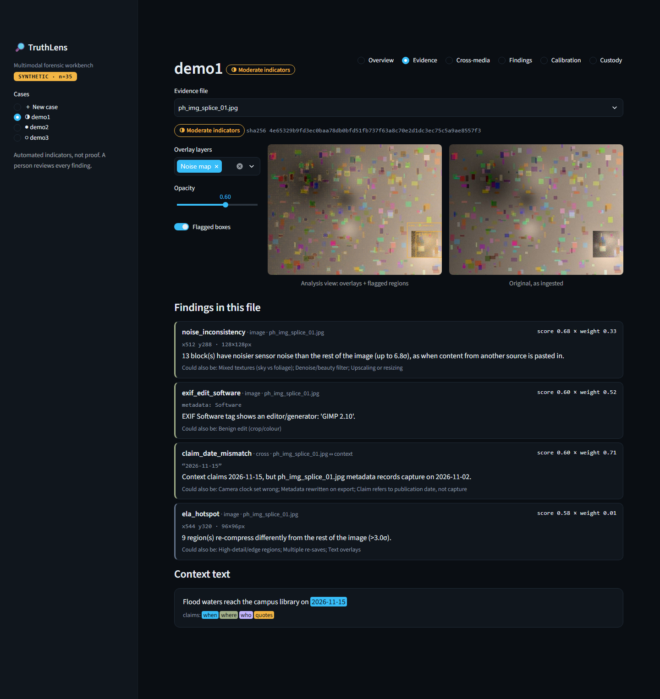

# TruthLens

Multimodal forensic workbench: image, video and audio evidence plus the caption that came with it go in; located,
explained, cross-checked **indicators** come out, fused into a cautious label (*No significant / Weak / Moderate /
Strong indicators of manipulation or synthetic generation*, or *Not analysed* / *Limited analysis* when checks could not
run) with calibrated weights and a full chain of custody. A person reviews every finding.

## Setup (5 commands, Windows PowerShell)
```
git clone https://github.com/lector-sys/truthlens; cd truthlens
python -m pip install -r requirements.txt           # + ffmpeg/ffprobe on PATH
copy .env.example .env                              # fill the GPU server URLs (docs/SERVER_SETUP.md)
python test_smoke.py                                # must print OK
python demo.py                                      # seeds demo1-3, opens the dashboard (--offline: cache only)
```

| Variable | Default | Used for |
|---|---|---|
| `LLM_PROVIDER` / `LLM_PROVIDERS` | `ollama` | providers tried in order; `groq` / `openai` (cloud) only if listed here |
| `OLLAMA_URL`, `TRUTHLENS_TEXT_MODEL`, `TRUTHLENS_VISION_MODEL` | none, `truthlens-vl` | claims, caption↔image/frames, visual artifacts, summary on the team GPU server |
| `WHISPER_URL` | none | transcripts with word timestamps (whisper.cpp server) |
| `C2PATOOL` | `c2patool` on PATH | full path to c2patool, if it isn't on the PATH the dashboard was started with |
| `GROQ_API_KEY`, `GROQ_MODEL`, `OPENAI_API_KEY`, `TRUTHLENS_MODEL` | none | optional cloud fallbacks (evidence leaves the laptop) |

Without a reachable server, model checks come from `cache/` or are recorded as *not run*, and the label says so.

### c2patool (verified C2PA manifests)
Without it, C2PA manifests are found by a byte scan and reported as "C2PA manifest present (not verified)". With it,
`synthetic_provenance` reads and validates the manifest: "verified by c2patool: signature and content hashes valid,
signed by <issuer>", "on the trust list" when c2patool has one configured, or "failed verification (<codes>)".
Install the official release (Content Authenticity Initiative, `contentauth/c2pa-rs`, v0.27.23) on Windows:
```powershell
$v = "c2patool-v0.27.23"
gh release download $v -R contentauth/c2pa-rs -p "$v-x86_64-pc-windows-msvc.zip" -D "$env:TEMP\c2patool"
# check: Get-FileHash ...zip must equal the sha256 "digest" GitHub shows for the asset
# (v0.27.23: b3fba7bdfb6f9c0b43d47e50d1db66785404f3e4b687e7127991157852b29cb5)
Expand-Archive "$env:TEMP\c2patool\$v-x86_64-pc-windows-msvc.zip" "$env:LOCALAPPDATA\Programs\c2patool" -Force
[Environment]::SetEnvironmentVariable("Path", $env:Path + ";$env:LOCALAPPDATA\Programs\c2patool\c2patool", "User")
c2patool --version          # in a NEW terminal; restart the dashboard afterwards
```
Programs started before the PATH change don't see it: set `C2PATOOL=<full path to c2patool.exe>` in `.env` instead.
Linux / macOS: the `x86_64-unknown-linux-gnu.tar.gz` / `universal-apple-darwin.zip` asset of the same release, or
`cargo install c2patool`. On the team laptop it is installed in `%LOCALAPPDATA%\Programs\c2patool\c2patool`.

## How it works
```
upload ─► vault (SHA-256, read-only copy, append-only log)
        ─► analyzers by type ── image: EXIF · ELA · noise map · copy-move · C2PA/XMP provenance · spectrum · visual artifacts
                              ├ video: metadata · per-frame ELA/noise · temporal spikes (not scene cuts)
                              └ audio: noise-floor splices · clicks · spectrogram · transcript
        ─► text: claims (truthlens-vl; regex offline)
        ─► cross-media: A/V flags within 0.5 s · caption↔image/frames · claimed date↔metadata · quote↔transcript
        ─► fusion: noisy-OR of score × calibrated weight (calibration.json)
        ─► dashboard (app.py) + self-contained HTML report
```
Every detector returns the frozen `Indicator` schema (`truthlens/indicator.py`). Model calls go only through
`truthlens/llm.py` (JSON schemas checked locally, evidence text fenced as untrusted, disk cache so re-runs make zero calls).

## Calibration
`python calibrate.py` runs `testset/labels.csv` (see [testset/COLLECTING.md](testset/COLLECTING.md)), fits per-detector
weights on 60% and reports held-out hit / false-alarm rates with Wilson 95% intervals into `calibration.json`, which
fusion and the dashboard load. Synthetic `ph_*` placeholder rows (`python testset/make_placeholder.py`) are refused unless
`--allow-placeholder`, and are then stamped SYNTHETIC everywhere.

## Screens
| Overview | Cross-media | Evidence |
|---|---|---|
|  |  |  |

More in `docs/screenshots/`. Demo script: [DEMO.md](DEMO.md) · limits: [docs/LIMITATIONS.md](docs/LIMITATIONS.md) ·
team brief: [TASKS.md](TASKS.md) · rules: [AGENTS.md](AGENTS.md) · state + open items: [NOTES_STATE.md](NOTES_STATE.md)
