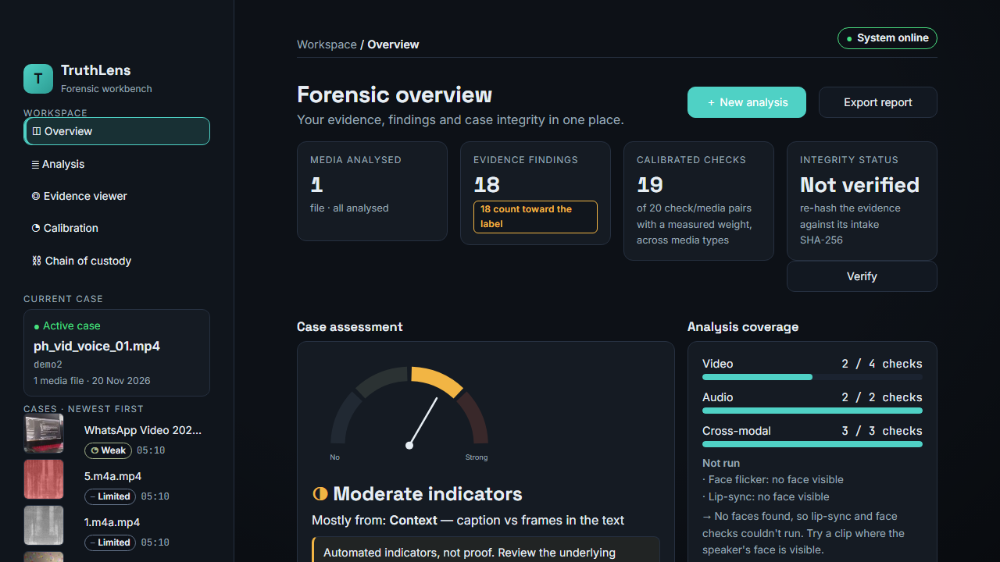
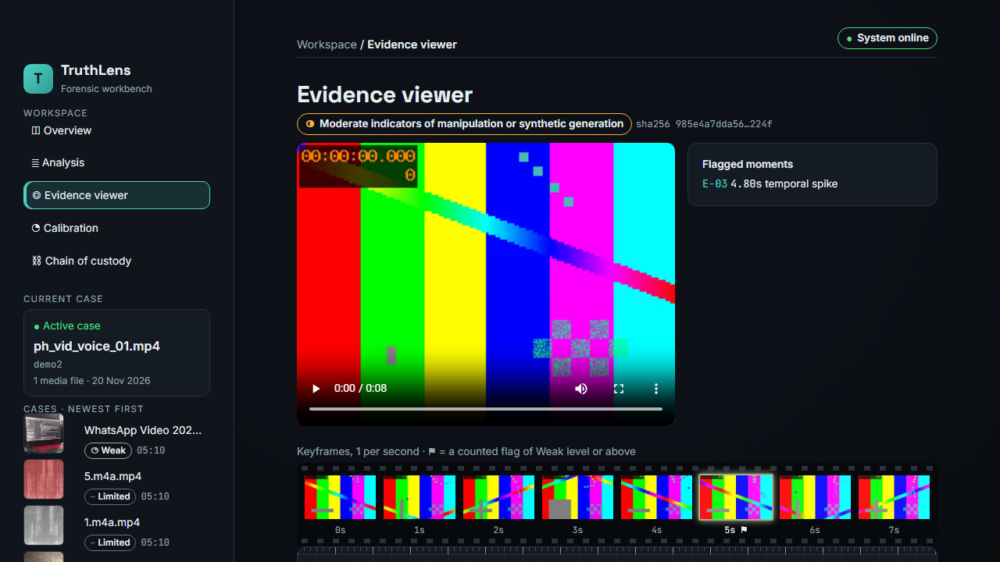
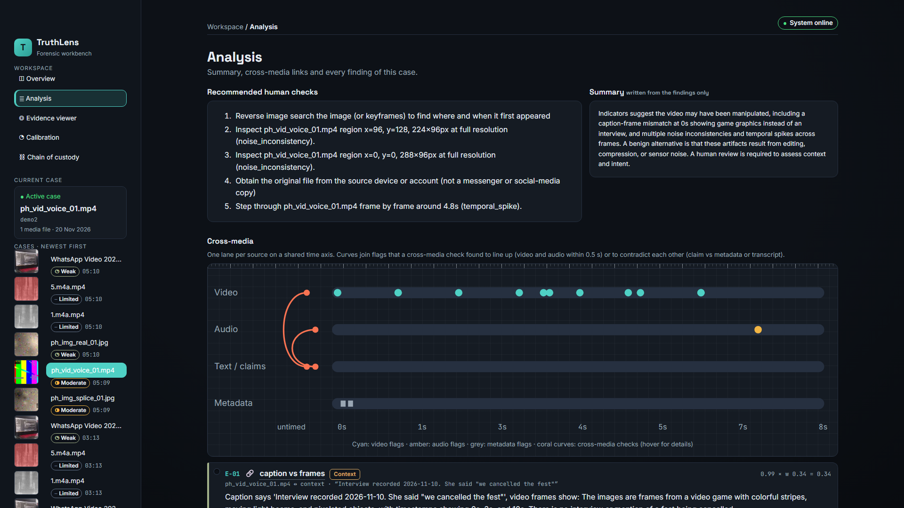
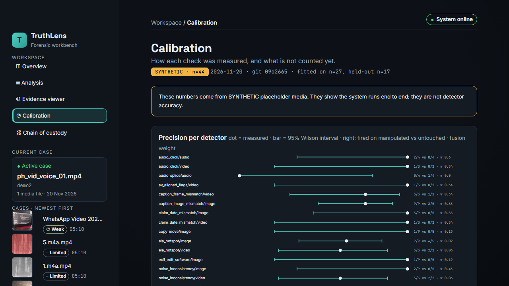
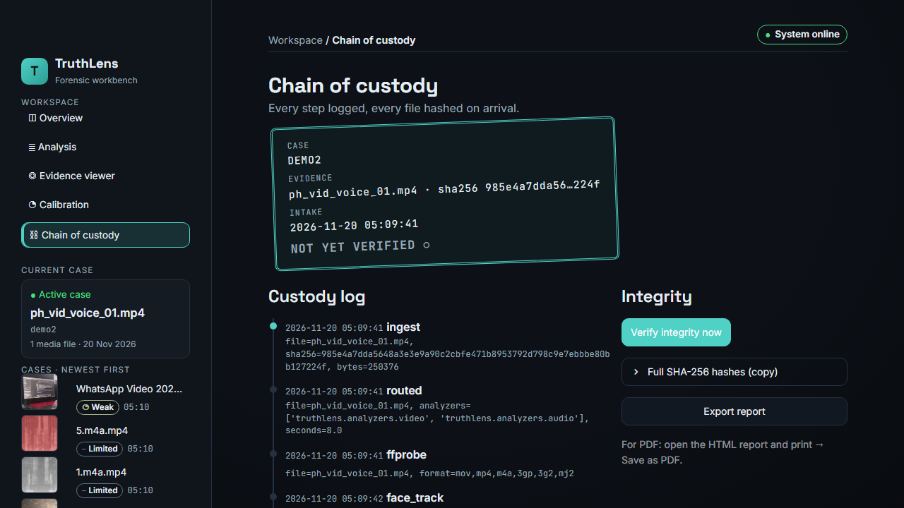
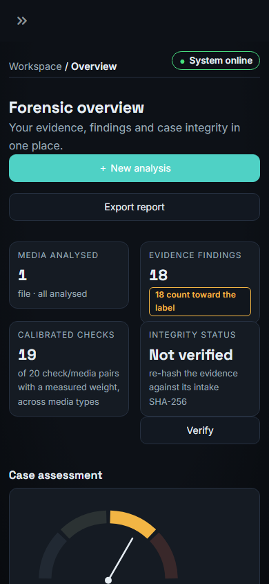

# TruthLens

**A multimodal forensic workbench for image, video and audio evidence.**
Team UNEX (team 144) · InnovEdge Hackathon 2026 · Problem Statement 04

Upload the media and the caption that came with it. TruthLens hashes and preserves the evidence, runs explainable
checks on every file, cross-checks the media against each other and against the claims, and fuses the results into a
cautious, calibrated label:

> *No significant / Weak / Moderate / Strong indicators of manipulation or synthetic generation*

Every finding points to where it is (region, frame, time span or text), explains why, and lists benign alternatives.
Automated indicators, not proof: a person reviews every finding.



## Quick start
```
git clone https://github.com/lector-sys/truthlens && cd truthlens
pip install -r requirements.txt        # plus ffmpeg / ffprobe on PATH
copy .env.example .env                 # add your model-server URLs
python test_smoke.py                   # prints OK
python demo.py                         # opens the dashboard with three demo cases
```
Settings, c2patool and public hosting: [docs/SETUP.md](docs/SETUP.md) · GPU server: [docs/SERVER_SETUP.md](docs/SERVER_SETUP.md)

## How it works
```
upload ─► evidence vault     SHA-256, read-only copy, append-only custody log
       ─► checks per media   image: EXIF · ELA · noise · copy-move · C2PA provenance · spectrum · visual artifacts
                             video: metadata · frame jumps · face flicker · keyframes
                             audio: splices · clicks · band limit · pauses · prosody · transcript
       ─► trained detectors  CLIP ViT-L/14 (image, video) · WavLM (audio), on the team's GPU
       ─► cross-media        caption vs image · date vs metadata · quote vs transcript · A/V alignment · lip-sync
       ─► fusion             noisy-OR of score × calibrated weight
       ─► dashboard + self-contained HTML report
```

| Laptop | Home GPU PC (over Tailscale) |
|---|---|
| Streamlit dashboard, evidence vault, CPU checks (OpenCV, NumPy, Pillow, ffmpeg), fusion, report | Ollama `truthlens-vl` · whisper.cpp · trained detectors (FastAPI) |

Language, vision and speech models run on the team's own GPU; evidence goes to a cloud AI only if explicitly enabled.

## Screens
| Evidence viewer | Analysis | Calibration |
|---|---|---|
|  |  |  |

| Chain of custody | Phone (390 px) |
|---|---|
|  |  |

## Calibration
Weights come from our labelled test set (`testset/labels.csv`, `python calibrate.py`), with Wilson 95% intervals and a
held-out split; a check without a measured weight counts 0 and says so. Trained detectors count only once a media type
has 10 untouched and 10 confirmed AI files of our own:

| Detector | Our AI files | Caught | False alarms | Weight |
|---|---|---|---|---|
| Image | 16 | 3 / 16 | 1 / 29 | 0.64 |
| Video | 13 | 2 / 13 | 0 / 23 | 0.72 |
| Audio | 4 | 2 / 4 | 10 / 116 windows | uncalibrated (needs 6 more) |

The test set still contains synthetic placeholder rows, so results are stamped SYNTHETIC. See [docs/LIMITATIONS.md](docs/LIMITATIONS.md).

## Repository
```
app.py              dashboard (Streamlit)        truthlens/          vault, pipeline, analyzers, fusion, report, llm
demo.py             seed demo cases + launch     calibrate.py        fit weights → calibration.json
test_smoke.py       end-to-end smoke test        testset/            labels.csv, hash lists, collecting guide
ui/, static/        theme and bundled fonts      docs/               setup, limitations, plan, notes, presentation
```

| Document | |
|---|---|
| [docs/presentation/](docs/presentation/) | pitch deck (PPTX, PDF) and project report |
| [docs/DEMO.md](docs/DEMO.md) | 3-minute demo script |
| [docs/LIMITATIONS.md](docs/LIMITATIONS.md) | what TruthLens can and cannot tell you |
| [docs/TASKS.md](docs/TASKS.md) · [docs/flowchart.html](docs/flowchart.html) | team brief, architecture and 24-hour plan |
| [docs/NOTES_STATE.md](docs/NOTES_STATE.md) | build log and open items |
| [AGENTS.md](AGENTS.md) | rules for contributors and coding agents |
