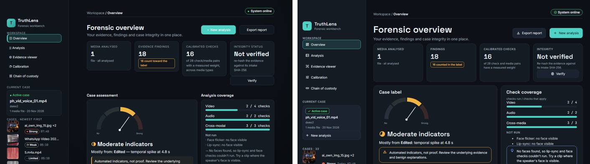
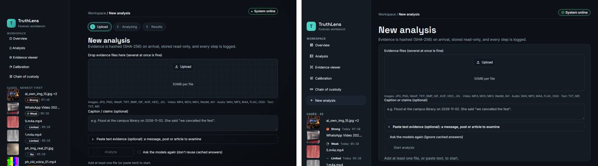
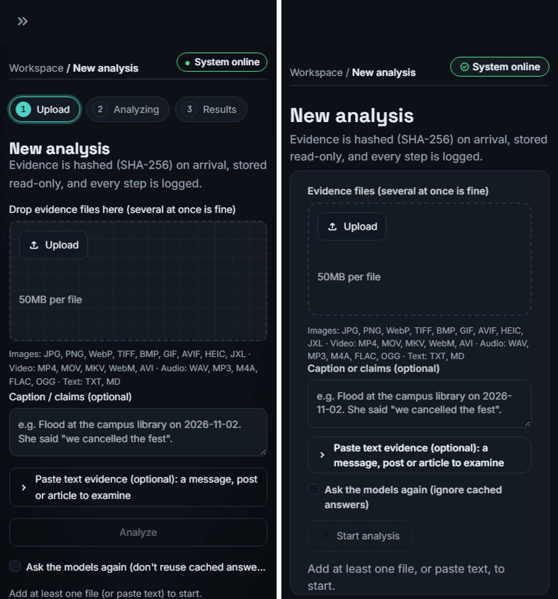
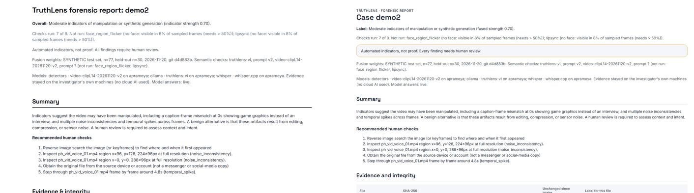
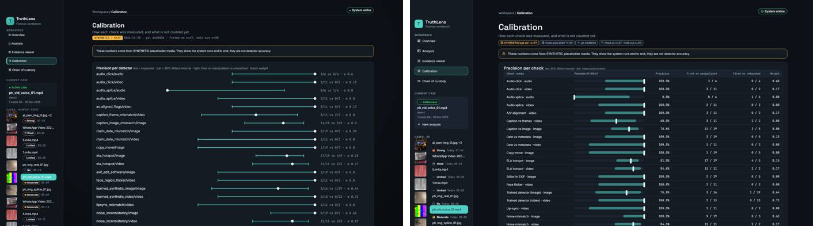
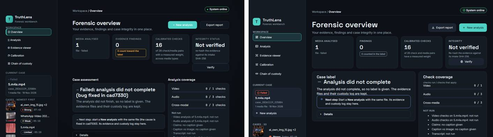
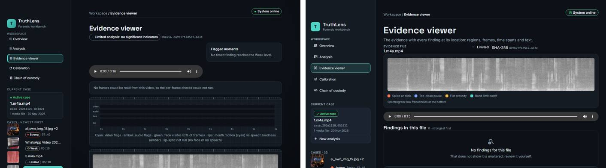
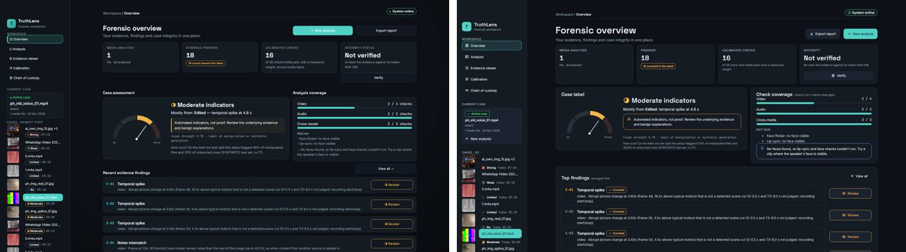
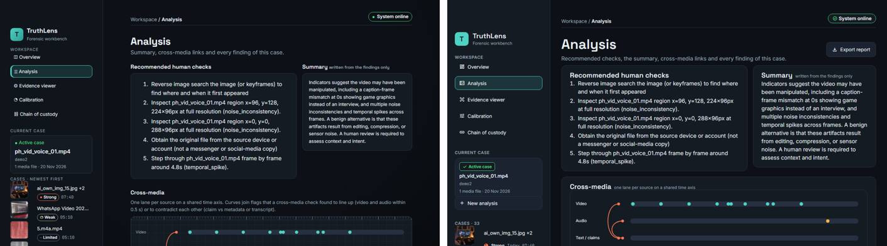
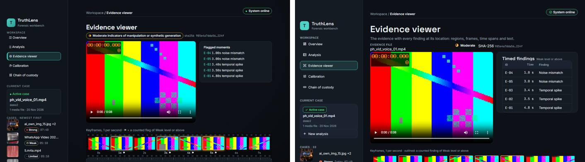

# UI audit (2026-11-20)

Every page and state was captured at 390 px, 1280×720, 1920×1080 and a tall 1280 view (64 screenshots, kept locally in
`docs/screenshots/v4/before/`, git-ignored). States: upload, overview (video case, image case), Analysis, Evidence
viewer (video, image, audio), Calibration (+ model card open), Chain of custody, failed case, provenance banner,
offline GPU server, public access gate, sidebar glossary open, HTML report. The *analysing* state was captured in the
after set only (it needs a live run). A crashed check (`analyzer_error`) does not exist in any case on disk, so its state
was checked in code only.

Screenshot references are `<state>_<size>`, e.g. `02_overview_demo2_1280`. Status: ✔ fixed · ✖ not fixed (reason).

| # | Sev | Page / shot | Issue | Fix | Status |
|---|---|---|---|---|---|
| 1 | high | all | No design tokens: 93 hard-coded hex colours in `app.py`, 24 in `theme.css`, 63 inline `style=` attributes | `ui/tokens.css` + `ui/components.py`; every colour, size and space from tokens || ✔ |
| 2 | high | all | 16 font sizes (0.72–1.9 rem) and 3 weights (400/600/700); no type scale | 6 sizes (12 · 14 · 16 · 20 · 28 · 40), weights 400/600 || ✔ |
| 3 | high | `01_upload`, buttons | Primary buttons: white text on teal `#4FD1C5`, contrast 1.9:1 (fails AA) | dark text on accent (11.2:1) || ✔ |
| 4 | high | `01_upload_390` | Checkbox label cut off: "Ask the models again (don't reuse cached answ…" | label wraps; shorter wording || ✔ |
| 5 | high | all | One concept, many names: "finding", "evidence tag", "flag", "flagged moment", "indicator"; "case" vs "analysis"; "Analyze"/"Analyzing" vs "analysed" | Finding · Label · Check · Case; British spelling throughout || ✔ |
| 6 | high | `16_report_html` | Report: words break mid-word ("noise_inconsisten cy"), 9 narrow columns, raw Python dict "Analysis log", different wording from the dashboard | report uses tokens, wording and wider columns; log as a table || ✔ |
| 7 | high | `08_calibration` | Raw internal keys shown to users ("learned_synthetic_image/image", "audio_click/video"); "0 untouched, 0 AI" wraps over 3 lines | plain check names + media; numeric columns right-aligned, no wrap || ✔ |
| 8 | high | `11_failed_case` | Developer jargon on screen: "Failed: analysis did not complete (bug fixed in cad7330)" | "Analysis did not complete" + plain next step; detail in the Details expander || ✔ |
| 9 | high | `07_evidence_audio` | Audio-only file shows an empty video timeline, "No frames could be read from this video", and duplicate ticks "0s 0s 0s 1s" | video panels only for files with a picture track; ticks rounded to distinct values || ✔ |
| 10 | high | `02_overview_demo2_*` | KPI row uneven: Verify button hangs under the Integrity tile, tiles 3 different heights | fixed tile height; Verify as the tile's action inside it || ✔ |
| 11 | medium | sidebar, tags, filters, upload list | Mixed icon sets: Unicode shapes (◫ ≣ ◎ ◔ ⛓ ◑ ◇) + colour emoji (🖼️ 🎞️ 🎙️ 🔗 🔏 📡 ⏳ ℹ️ ⚠️) at different sizes | one inline-SVG line icon set, 16 px, always with a text label || ✔ |
| 12 | medium | `04_analysis`, `05_evidence_*` vs `02_overview` | Two finding components: overview rows vs "tag cards" with different title casing, score format and colours | one Finding row component everywhere || ✔ |
| 13 | medium | tag cards | Group chip "Context" uses amber, the same as the Moderate level; "Edited" blue, "Generated" violet off-palette | group chips neutral with text; indicator colours reserved for levels || ✔ |
| 14 | medium | all | Border radii 4/6/8/10/12/999 px mixed (cards 12, tags 4/12 asymmetric, stamp 8, chips 6, case card 10) | 6 inputs & chips · 10 buttons · 14 cards · 999 pills || ✔ |
| 15 | medium | `02_overview` | "View all →" floats above its section heading, misaligned with the cards | Card header pattern: title left, action right on one line || ✔ |
| 16 | medium | all | Page header differs per page (overview has actions, others none; upload uses a step bar) | one page header: breadcrumb, title, description, primary action right || ✔ |
| 17 | medium | `10_custody` | Custody log: raw `key=value` dumps, wrapping mid-hash; headings larger than card titles | log as table rows (time · action · details), monospace values truncated with full value on hover || ✔ |
| 18 | medium | dates | "20 Nov 2026", "2026-11-20 05:09:41", "05:10", "19 Nov" mixed | "20 Nov 2026, 05:09" everywhere; case list "Today 05:10" / "19 Nov" || ✔ |
| 19 | medium | numbers | "4.80s" vs "4.8 s"; percentages without decimals; score formats differ | durations "4.8 s", scores 2 dp, percentages 1 dp || ✔ |
| 20 | medium | `09_calibration_modelcard` | Model card markdown renders 44 px headings, outside the type scale | model card headings mapped to the scale inside a scrollable card || ✔ |
| 21 | medium | `14_public_gate` | Access gate: no logo, bare form, no notice | branded gate card with the demo notice || ✔ |
| 22 | medium | `13_offline_gpu` | Offline server only shows a grey pill; nothing says what it affects | info notice: model checks come from cache or are recorded as not run || ✔ |
| 23 | medium | analysing | Page title is the raw case ID; step bar duplicates the sidebar nav | title "Analysing case", ID as mono sub-text || ✔ |
| 24 | medium | `05_evidence_image` | Overlay controls are default Streamlit widgets in an uneven 3-column row; no common toolbar | toolbar card: layers · opacity · regions, equal heights || ✔ |
| 25 | medium | evidence legends | Heatmap, film-strip, timeline and score-strip captions in 4 different styles | one Legend component (swatch + label) || ✔ |
| 26 | medium | Streamlit chrome | Header bar, "Running…" status widget, default spinners, toolbar menu | chrome hidden; status widget hidden; progress component || ✔ |
| 27 | medium | sidebar | 33 cases in one long list; repeated file names without context | case list capped with "Show all"; entries show date + label || ✔ |
| 28 | medium | `04_analysis` | Filter chips (Evidence type / Status / Media) unlabeled as a group, media chips with emoji | filter toolbar with labels, no emoji || ✔ |
| 29 | low | tag cards | Check names lowercase ("temporal spike") vs Sentence case elsewhere | Sentence case || ✔ |
| 30 | low | `11_failed_case` | "0 count toward the label" chip in amber when 0 | neutral chip when 0 || ✔ |
| 31 | low | `05_evidence_*` | Long label pill "Moderate indicators of manipulation or synthetic generation" vs short pills elsewhere | Indicator label component, small size || ✔ |
| 32 | low | `08_calibration` | "SYNTHETIC · n=77" badge run together with git/date metadata line | badge + meta as separate chips || ✔ |
| 33 | low | coverage | "·" and "→" used as list markers | real lists; hint as a Notice || ✔ |
| 34 | low | `01_upload` | Disabled "Analyze" button almost invisible; "50MB per file" (Streamlit text) | disabled style from tokens; limits line below the drop zone || ✔ disabled style from tokens; the "50MB per file" line inside the drop zone is Streamlit's own text and stays |
| 35 | low | `04_analysis` | Cross-media lane labels in SVG use fixed 12–14 px, not the scale | SVG text from tokens || ✔ |
| 36 | low | `01_upload_390` | Sidebar toggle "»" is the default Streamlit icon | kept: it is the platform menu button; restyled || ✖ kept on purpose: it is Streamlit's sidebar menu button (needed at 390 px); restyled by the theme only |
| 37 | low | `15_glossary_open` | Glossary inside the sidebar pushes the footer far down | glossary moved to a page-level dialog-style expander under Calibration || ✔ |
| 38 | low | all | Focus ring only on some custom elements | one focus ring token on every interactive element || ✔ |

## Result
38 items: 37 fixed, 1 kept on purpose (#36). Analysis results, labels, scores, weights and custody logs are byte-identical
before and after for all 33 cases (SHA-256 of every `result.json` and `log.jsonl`, plus the recomputed label and weights).
Full after set: `docs/screenshots/v4/after/` (git-ignored); README picks in `docs/screenshots/v4/`.

## Before / after (worst 10)
Left: before · right: after.

**#1**

**#3**

**#4**

**#6**

**#7**

**#8**

**#9**

**#10**

**#11**

**#12**

